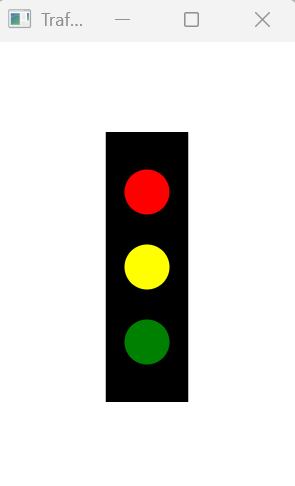
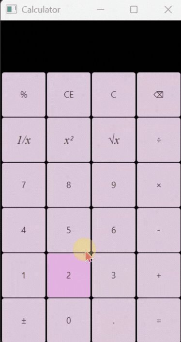
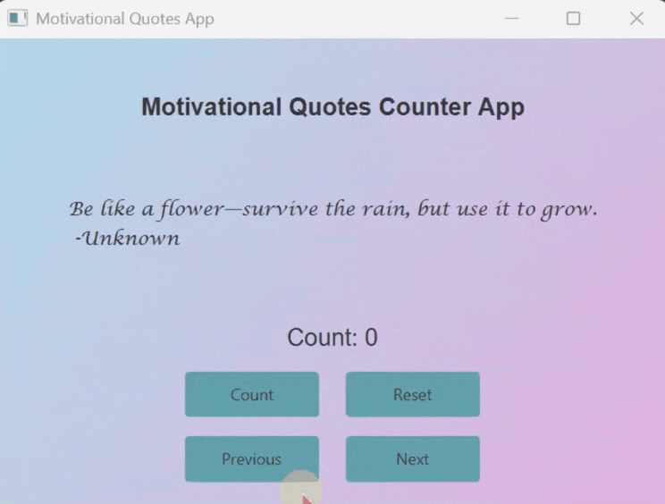

# Homework 3 – JavaFX GUI Apps: Traffic Light, Calculator & Quote Counter

Three JavaFX programs practicing GUI design, layouts, shapes and event handling.

## 1. Traffic Light
Draws a traffic light in a 200×300 window, using a `Rectangle` for the body and three `Circle` shapes for the red, yellow and green lights.

## 2. Calculator
A fully working calculator modelled on the Windows calculator, built with a `GridPane` of buttons generated from a 2D array.
- Basic operations (+, −, ×, ÷) plus %, 1/x, x², √x and ± (sign change)
- **C**, **CE** and **⌫** (backspace) for clearing and editing input
- A history line above the display showing the current calculation
- Edge-case handling: dividing by zero, 0 ÷ 0, the square root of a negative number, and repeated decimal points
- Whole-number results display without a trailing `.0`
- Hover and press effects on the buttons

## 3. Motivational Quote Counter
Shows one quote at a time from a set of five, including quotes from UAE leaders and classical Arab poets. Four buttons:
- **Count:** increases the counter by 1
- **Reset:** sets the counter back to 0
- **Next / Previous:** move through the quotes and reset the counter, wrapping around at either end like a circular list

Features a gradient background, a fixed-size quote area that keeps the layout stable, and hover and press effects on the buttons.

**Concepts:** JavaFX shapes (`Rectangle`, `Circle`), layouts (`GridPane`, `VBox`, `HBox`), `Button`, `Label` and `TextField` controls, event handling with lambdas, mouse events, 1D and 2D arrays

## Running
Requires the JavaFX SDK. If you're using a modular JavaFX project (for example, IntelliJ's JavaFX template), add your project's package declaration as the first line of each file, e.g.:

`package com.example.demo;`
