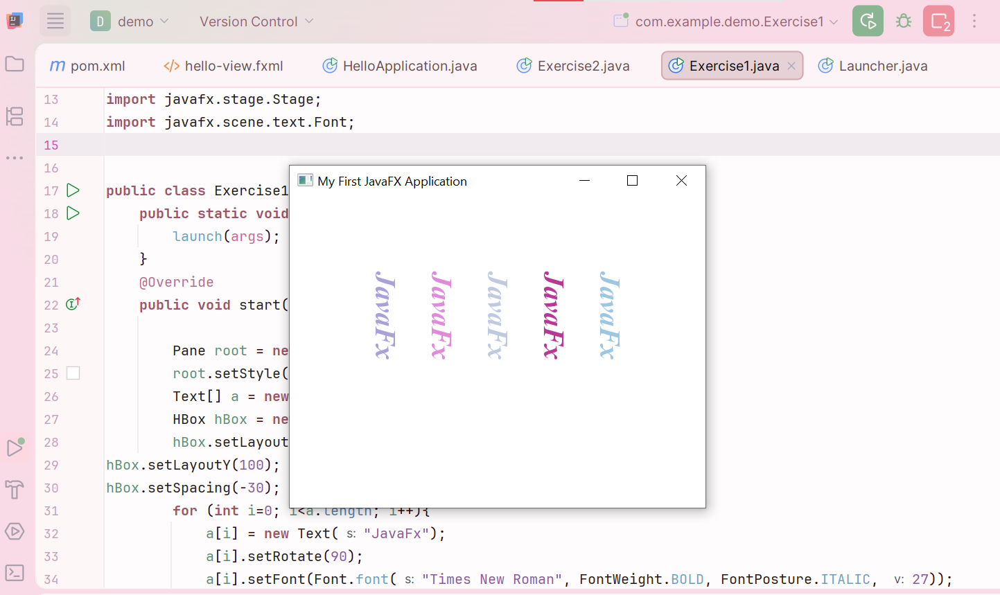
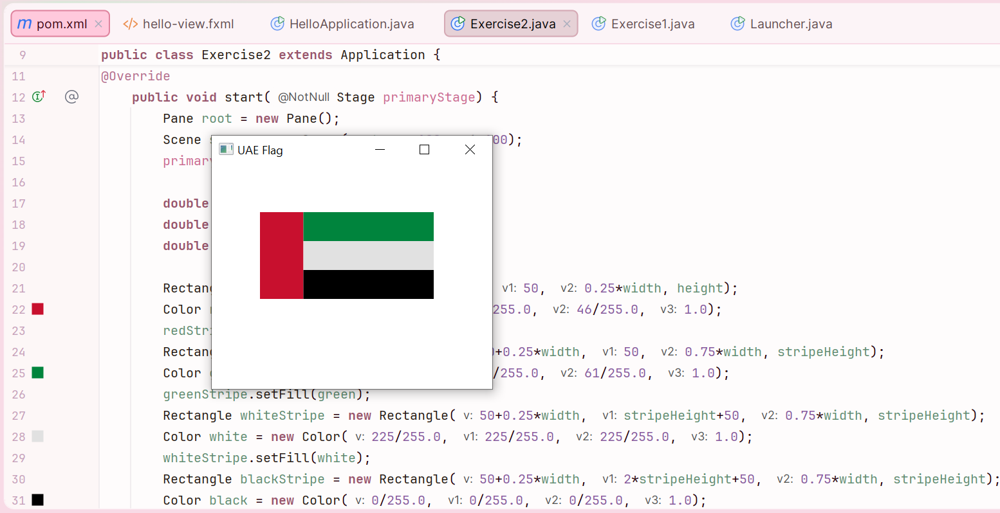

# Lab 10 – JavaFX Basics: Text & Shapes

Two JavaFX GUI programs practicing scenes, layouts, text styling and drawing basic shapes.

## 1. Five Random Texts
Displays five texts stacked vertically, each in Times New Roman (bold, italic, 27px) with a **random colour and opacity** that changes every time the program runs.

## 2. UAE Flag
Draws the United Arab Emirates flag using JavaFX `Rectangle` and `Color` classes, following the official flag guidelines for proportions and colours. All rectangle positions and sizes are calculated from the chosen flag height, so the flag scales correctly (e.g. heights of 90 and 180).

**Concepts:** JavaFX `Application`, `Stage` and `Scene`, `VBox` and `Pane` layouts, `Text` and `Font`, `Rectangle`, `Color`, random colour generation

## Running
Requires the JavaFX SDK to be configured in your project (JavaFX is not included in the standard JDK since Java 11).

